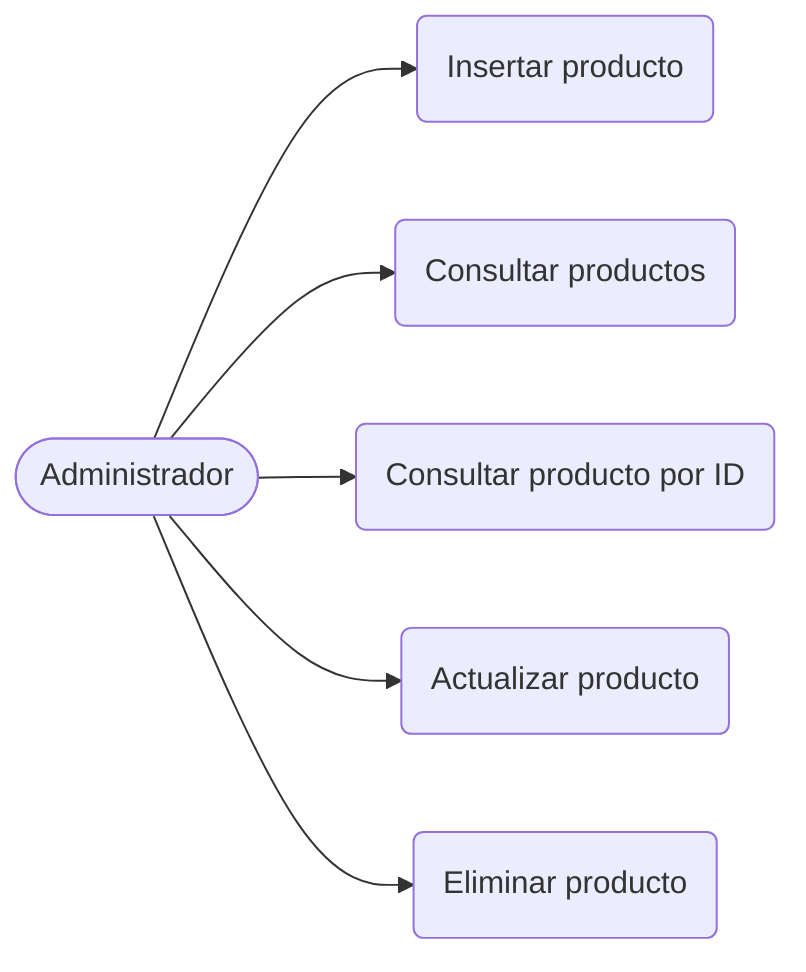
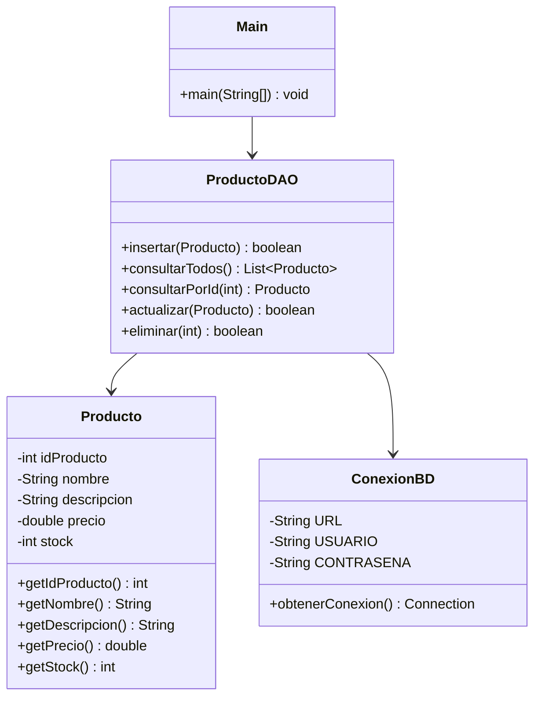

# Diseño del módulo de Inventario - GA7-220501096-AA2-EV01

**Aprendiz:** Maryury Cardenas Ortega
**Ficha:** 3336248
**Programa:** Análisis y desarrollo de software

## 1. Descripción del módulo
Módulo de gestión de productos de un inventario. Permite registrar, consultar,
modificar y eliminar productos, almacenados en una base de datos MySQL a la
que se accede mediante JDBC.

## 2. Tecnologías seleccionadas
| Componente | Tecnología |
|---|---|
| Lenguaje | Java 17 |
| Base de datos | MySQL |
| Acceso a datos | JDBC (mysql-connector-j) |
| Gestor de dependencias | Maven |
| Editor | Visual Studio Code |
| Versionamiento | Git y GitHub |

## 3. Historias de usuario
| ID | Como... | Quiero... | Para... |
|---|---|---|---|
| HU-01 | administrador | registrar un producto con nombre, descripción, precio y stock | tener el inventario actualizado |
| HU-02 | administrador | consultar la lista de todos los productos | conocer lo que hay en inventario |
| HU-03 | administrador | consultar un producto por su ID | ver sus datos de forma rápida |
| HU-04 | administrador | actualizar los datos de un producto | corregir precio, stock u otros datos |
| HU-05 | administrador | eliminar un producto | retirar del inventario lo que ya no se maneja |

**Criterios de aceptación:** el sistema muestra un mensaje de confirmación en cada
operación y un mensaje de error cuando el ID no existe.

## 4. Casos de uso


| Caso de uso | Actor | Descripción | Historia |
|---|---|---|---|
| Insertar producto | Administrador | Registra un producto nuevo en la base de datos | HU-01 |
| Consultar productos | Administrador | Lista todos los productos | HU-02 |
| Consultar por ID | Administrador | Busca un producto específico | HU-03 |
| Actualizar producto | Administrador | Modifica los datos de un producto existente | HU-04 |
| Eliminar producto | Administrador | Borra un producto por su ID | HU-05 |

## 5. Diagrama de clases


## 6. Modelo de datos
Tabla `producto`: `id_producto` (PK, autoincremental), `nombre`, `descripcion`,
`precio`, `stock`. Script en `database/script.sql`.

## 7. Prototipo de interfaz (consola)
```
===== INVENTARIO DE PRODUCTOS =====
1. Insertar producto
2. Consultar todos los productos
3. Consultar producto por ID
4. Actualizar producto
5. Eliminar producto
0. Salir
Seleccione una opción:
```

## 8. Plan de trabajo
| Etapa | Actividad |
|---|---|
| 1 | Crear el proyecto Maven y el repositorio Git |
| 2 | Crear la base de datos y la tabla `producto` |
| 3 | Codificar la conexión JDBC (`ConexionBD`) |
| 4 | Codificar el modelo y el DAO con el CRUD |
| 5 | Codificar el menú de consola y probar |
| 6 | Documentar y subir el proyecto a GitHub |
